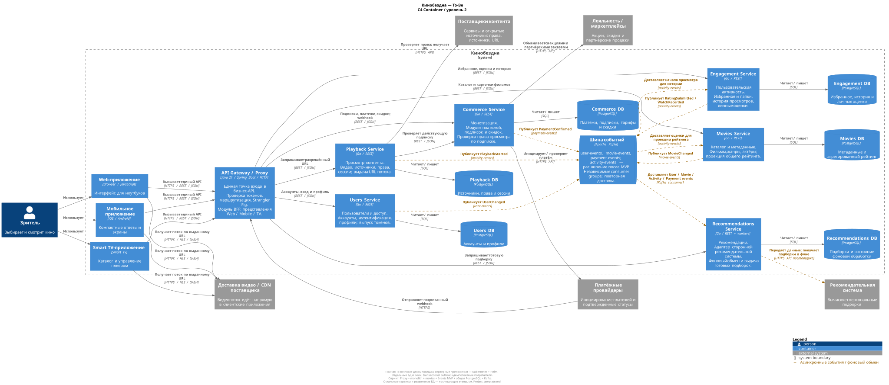
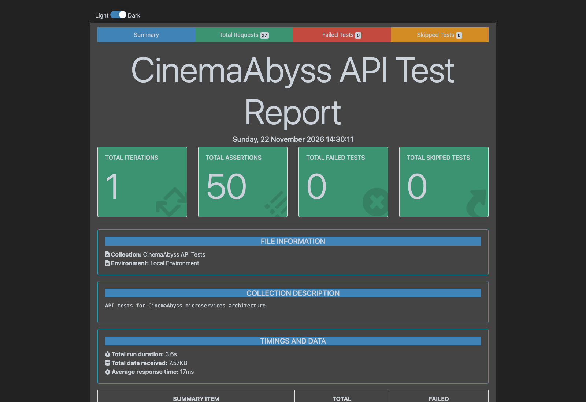
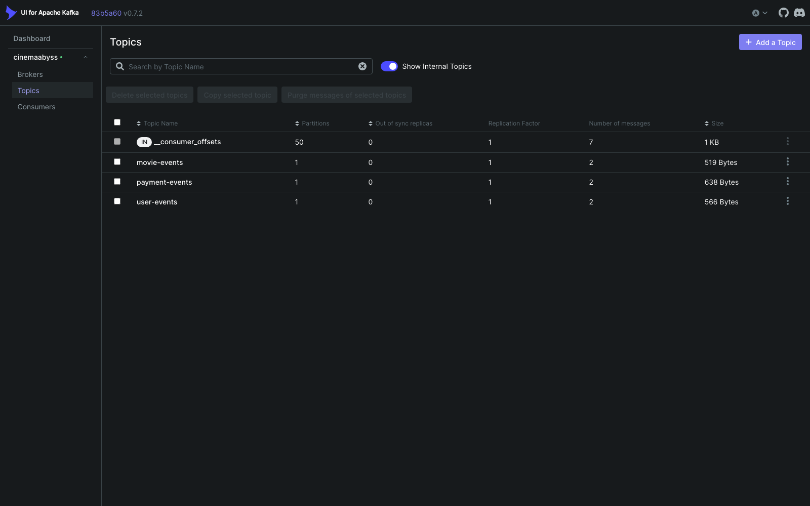
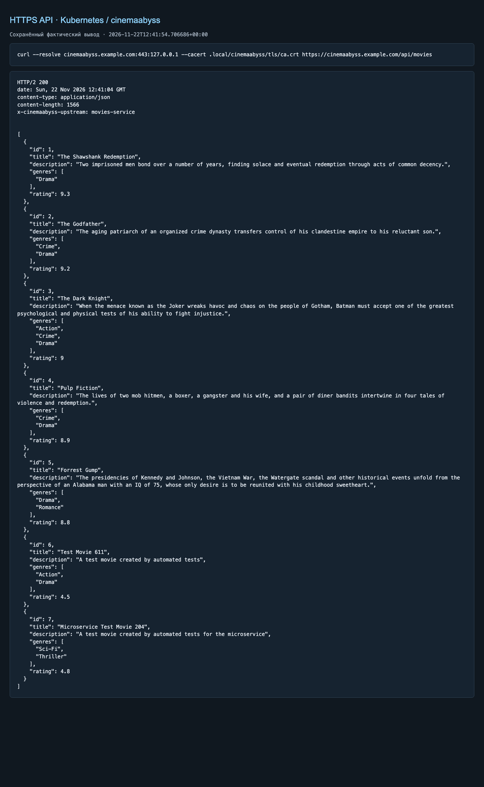
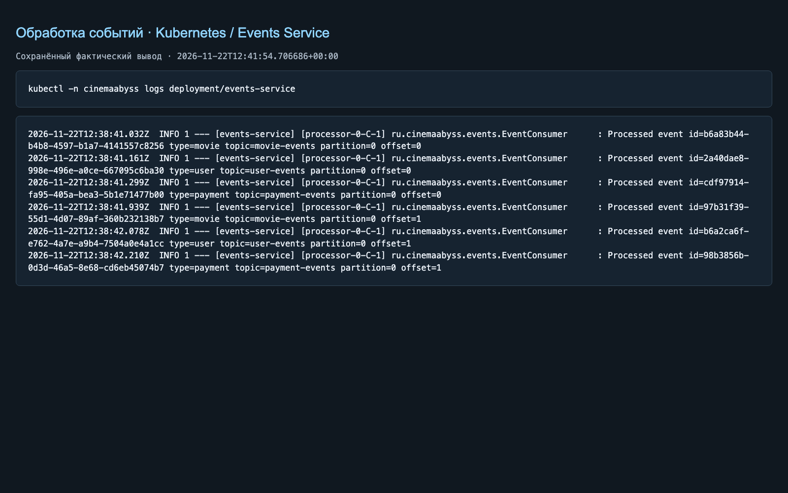

## Изучите [README-правка.md](README-правка.md) файл и структуру проекта.

# Задание 1

## Контейнерная диаграмма C4 — To-Be

- [Посмотреть диаграмму в SVG](docs/architecture/to-be.svg).
- [Исходник PlantUML](docs/architecture/to-be.puml).



Диаграмма показывает целевую систему после завершения декомпозиции. Внутри границы «Кинобездна» находятся клиентские и серверные приложения, хранилища и Kafka; снаружи — зритель и системы партнёров. У контейнеров указаны назначение и технология, у связей — направление и способ взаимодействия. Сплошные связи обозначают синхронные запросы, пунктирные охристые — события и фоновый обмен. Видеопоток отделён от управляющего API.

Исходник использует встроенную библиотеку C4-PlantUML (`!include <C4/C4_Container>`) и Java-движок Smetana. Для воспроизведения SVG не нужны сетевые include или установленный Graphviz:

```bash
java -jar /path/to/plantuml.jar -charset UTF-8 -tsvg docs/architecture/to-be.puml
```

Полная To-Be — ориентир для дальнейшего развития. Результат ближайших двух месяцев: перенос существующей системы в Kubernetes, выделенный `movies`, `proxy`, Kafka MVP `events`, Helm и CI/CD. Выделение остальных доменов не включается в этот срок.

## Отправная точка

По условию система представляет собой Go-монолит с одной PostgreSQL, синхронными вызовами и внешней асинхронной рекомендательной системой. Она обслуживает пользователей, фильмы и видео, платежи, подписки, скидки, личные оценки и избранное.

В стартовом коде [монолит](src/monolith/main.go) уже сосуществует с [movies](src/microservices/movies/main.go). Согласно [Compose](docker-compose.yml), они подключаются к одной базе, причём оба читают и изменяют таблицы `movies` и `movie_genres`. В [SQL-схеме](src/database/init.sql) также есть пользователи, платежи, подписки, просмотры и личные оценки. Аутентификация, папки избранного, актёры и полноценное воспроизведение предусмотрены требованиями, но соответствующие бизнес-сценарии в стартовом API не реализованы. Ниже описывается проектное решение, а не утверждение об их готовности.

## Домены и владение данными

| Домен | Контейнер | Ответственность и собственные данные |
| --- | --- | --- |
| Пользователи и доступ | **Users Service**, Go + Users DB, PostgreSQL | Аккаунты, аутентификация, профили, выпуск токенов. Владелец идентификатора пользователя. |
| Каталог и метаданные | **Movies Service**, Go + Movies DB, PostgreSQL | Фильмы, описания, жанры, актёры, длительность, постеры. Хранит проекцию общего рейтинга; личные оценки принадлежат Engagement. |
| Пользовательская активность | **Engagement Service**, Go + Engagement DB, PostgreSQL | Личные оценки, папки и избранное, история просмотров. Пользовательские действия порождают события для рейтинга и рекомендаций. |
| Рекомендации | **Recommendations Service**, Go + Recommendations DB, PostgreSQL | Адаптер сторонней рекомендательной системы, фоновые задания и готовые персональные подборки. Алгоритм рекомендаций остаётся внешним. |
| Монетизация | **Commerce Service**, Go + Commerce DB, PostgreSQL | Модули платежей, подписок и скидок; тарифы и право просмотра по подписке. Интеграции с платёжными провайдерами, лояльностью и маркетплейсами. |
| Просмотр контента | **Playback Service**, Go + Playback DB, PostgreSQL | Видео, соответствие фильма источникам, права поставщиков, сессии просмотра и выдача разрешённого URL потока. Сами видеоданные поступают от поставщиков/CDN. |

Платежи, подписки и скидки объединены в один сервис монетизации: их правила тесно связаны, а команду из пяти Go-разработчиков не стоит сразу нагружать отдельным развёртыванием каждой сущности. Внутренние модули отделяют платёжную логику от управления подпиской и акциями. При необходимости их можно выделить позже. Для доменных сервисов сохраняется Go в соответствии с компетенциями команды. Инфраструктурные Proxy и Events в задании 2 реализуются отдельно на Java 21 / Spring Boot.

Каждый сервис — единственный владелец своих данных и миграций. В To-Be у него отдельная логическая БД и роль PostgreSQL; доступ к таблицам других доменов запрещён. На старте эти БД могут находиться в одном PostgreSQL-кластере, но это сохраняет общую точку отказа и предел масштабирования. Нагруженные домены можно переносить на отдельные кластеры независимо. Междоменные ссылки передаются как идентификаторы; внешних ключей между базами и межсервисных SQL JOIN нет.

## Единая точка входа и клиентские приложения

**API Gateway / Proxy** — общий публичный адрес REST API для Web, Mobile и Smart TV. Kubernetes Ingress завершает TLS и направляет бизнес-API в Gateway; внутренние сервисы доступны через ClusterIP. Gateway проверяет токены, ограничивает нагрузку и маршрутизирует запросы, а доменные сервисы проверяют права на конкретные ресурсы. Выпуск токенов выполняет Users Service; проверка подписанного токена не требует синхронного запроса к Users для каждого обращения.

В целевой версии Gateway содержит модуль BFF с представлениями Web/Mobile/TV: он собирает экран из нескольких API и отдаёт нужные поля, размеры изображений и объём списка. Доменные модели от типа устройства не зависят. Существующие маршруты `/api/movies`, `/api/users`, `/api/payments`, `/api/subscriptions` сохраняются. На этапе задания 2 Proxy выполняет маршрутизацию по существующим контрактам; BFF и полноценная аутентификация относятся к последующим этапам.

Единая точка входа относится к бизнес-API. После получения разрешённого URL клиент скачивает поток напрямую у поставщика/CDN, чтобы Gateway не становился узким местом для видео. Уведомления платёжного провайдера также проходят через Gateway в Commerce; Commerce проверяет подпись и защищается от повторной обработки.

## Интеграционное взаимодействие

**Синхронный REST/JSON** используется, когда результат необходим для ответа пользователю:

1. Клиент → Gateway → Movies: список фильмов и карточка с метаданными.
2. Клиент → Gateway → Users / Engagement / Commerce: работа с профилем, избранным, оценками и подпиской.
3. Клиент → Gateway → Playback → Commerce: проверка действующей подписки; Playback дополнительно проверяет права на источник и выдаёт URL просмотра. При недоступной проверке новый доступ не выдаётся; поток уже разрешённой сессии не проходит через эти сервисы.
4. Commerce → платёжный провайдер: инициирование платежа с ключом идемпотентности. Ответ о начале платежа ещё не означает успешную оплату. Подтверждённый статус провайдера обрабатывается в Commerce; платёж, активация подписки и outbox-событие фиксируются локальной транзакцией.

На внешних HTTP-вызовах задаются таймауты и ограничение параллелизма; повторяются только безопасные либо идемпотентные операции. Отказ рекомендаций не должен блокировать каталог и воспроизведение.

**Асинхронные события через Kafka** распространяют уже совершившиеся изменения:

| Издатель | Топик и примеры событий | Потребитель и результат |
| --- | --- | --- |
| Users | `user-events`: `UserChanged` | Recommendations актуализирует данные для подбора. |
| Movies | `movie-events`: `MovieChanged` | Recommendations обновляет сведения о каталоге. |
| Engagement | `activity-events`: `RatingSubmitted`, `WatchRecorded` | Movies обновляет проекцию общего рейтинга; Recommendations учитывает активность. |
| Playback | `activity-events`: `PlaybackStarted` | Engagement добавляет запись истории; Recommendations учитывает начало просмотра. Реальный прогресс просмотра поступает через API Engagement. |
| Commerce | `payment-events`: `PaymentConfirmed` | Recommendations может использовать факт покупки; событие также доступно будущим интеграциям. Подписку активирует сам Commerce, а не внешний потребитель. |

Имена `user-events`, `movie-events`, `payment-events` соответствуют топикам стартового Compose. `activity-events` и перечисленные доменные типы — целевое расширение после MVP. Movies обрабатывает только события оценок, даже если в том же топике есть другие виды активности. Каждый сервис-подписчик использует собственную consumer group; внутри группы экземпляры делят партиции.

Recommendations читает события и в фоне взаимодействует с API внешней рекомендательной системы. Точный протокол получения результатов адаптируется к возможностям поставщика; поддержка Kafka внешней системой не предполагается. Готовые подборки сохраняются локально и выдаются по REST. При задержке расчёта доступны последняя подборка или обычный каталог.

Бизнес-сервисы публикуют события через **transactional outbox**: изменение состояния и запись события выполняются одной транзакцией в собственной БД, затем фоновый издатель доставляет событие в Kafka. Конверт содержит `event_id`, тип, версию, время, идентификатор сущности и `correlation_id`. Доставка — как минимум однократная: потребители обрабатывают дубли идемпотентно и фиксируют offset после успешного сохранения результата. Ключ партиции задаётся по сущности, для оценок — по пользователю и фильму; версия защищает проекции от устаревших обновлений. Повторные попытки ограничены, необрабатываемые события отправляются в DLQ с оповещением. Проекции рейтингов и рекомендаций согласуются в конечном счёте, финансовое состояние и право доступа остаются в транзакционных данных Commerce.

**Events Service из задания 2 — инфраструктурный MVP**, который принимает `/api/events/{user,payment,movie}`, публикует события и сам читает их с записью в лог. Он проверяет работу Kafka, но не является владельцем бизнес-данных или обязательным посредником между всеми сервисами. Тестовый запрос `PaymentEvent` не подтверждает реальную оплату и не активирует подписку. В To-Be доменные события создают владельцы данных; поэтому Events MVP не показан отдельным бизнес-доменом на целевой диаграмме.

## Переход без простоя

1. **Фасад перед монолитом.** Сначала Gateway направляет существующий API в монолит. Совместимость URL, методов, статусов и JSON проверяется контрактными тестами; переход клиентам не требует обновления API.
2. **Strangler Fig для movies.** При `GRADUAL_MIGRATION=true` доля `MOVIES_MIGRATION_PERCENT=0` оставляет запросы к фильмам в монолите, `1–99` распределяет их между монолитом и Movies, `100` полностью переводит в Movies. Остальной бизнес-API остаётся в монолите. Долю увеличивают после сравнения ответов, ошибок и задержек. На этом этапе оба обработчика используют существующие общие таблицы, поэтому переключение чтения не теряет новые фильмы; записи также должны соблюдать один совместимый контракт и ограничения БД. При регрессии значение возвращают к `0` с применением конфигурации.
3. **Kubernetes, Helm, CI/CD и Kafka MVP.** За ближайшие два месяца разворачиваются монолит, Movies, Proxy и Events MVP; добавляются автоматическая сборка образов и API-тесты. Переключение трафика начинается после готовности нового окружения, старое сохраняется на период проверки и отката. В учебных заданиях проверяется локальный кластер, фактический промышленный переезд ими не подтверждается.
4. **Отделение данных Movies.** Сначала переключается единственный путь записи в Movies, включая обращения старого кода через его API. Затем выполняются фоновое копирование согласованного снимка в новую БД и доставка изменений через CDC с соответствующей позиции журнала. После устранения отставания один писатель дожидается завершения операций старой БД, выполняются финальная сверка и синхронизация sequence идентификаторов, затем переключается подключение. Новые запросы на запись кратко ожидают переключения в пределах HTTP-таймаута; ответ `201` возвращается только после фактического commit. Длительность переключения и сохранение контракта предварительно проверяются на стенде под нагрузкой. Процентное распределение записей между независимыми БД без синхронизации не допускается. После разделения БД простой возврат процента к нулю небезопасен: откат требует актуального старого хранилища и согласованного переноса владельца записи.
5. **Остальные домены.** Аналогичным образом выделяются Users, Engagement, Commerce, Playback и Recommendations с собственными БД и событиями. После удаления последних маршрутов в монолит и проверки отсутствия обращений он выводится из эксплуатации; временный доступ к общей БД закрывается.

Изменения схемы выполняются по expand/contract: сначала добавляются совместимые поля, старые удаляются после обновления всех потребителей. Для обновления приложений планируются readiness/startup/liveness-пробы, graceful shutdown, минимум два экземпляра критичных stateless-сервисов, RollingUpdate с `maxUnavailable: 0`, ресурсы для дополнительного экземпляра и распределение по узлам. HPA масштабирует приложения по нагрузке; для consumers учитывается lag и число партиций Kafka. Kubernetes сам по себе не делает одиночную PostgreSQL или Kafka отказоустойчивой: для промышленной среды нужны репликация по независимым узлам, устойчивые тома, резервные копии и проверка восстановления. Учебные одноузловые конфигурации этого не гарантируют.

Приёмку каждого этапа определяют API-тесты, доступность пользовательских сценариев, частота ошибок, задержки, сверка данных и lag событий. Метрики Gateway различают монолит и Movies; `correlation_id` связывает HTTP-запросы, логи и события. Это позволяет оценивать миграцию и принимать решение об откате по наблюдаемым результатам.

# Задание 2

## 1. Proxy — Spring Boot / Java 21

[Исходники Proxy](src/microservices/proxy) — самостоятельное Maven-приложение на Spring Boot 3.5.16 и Java 21. Multi-stage Dockerfile собирает исполняемый JAR и запускает его в JRE 21. Сервис не содержит бизнес-логики монолита и работает как HTTP-фасад для Strangler Fig.

| Маршрут | Назначение |
| --- | --- |
| `GET /health` | Локальный health Proxy: `Strangler Fig Proxy is healthy`. |
| `/api/events` и его подмаршруты | Events Service, независимо от флага миграции фильмов. |
| `/api/movies/health` | Всегда Movies Service: в монолите такого health-check нет. |
| `/api/movies` и его подмаршруты | Выбор монолита или Movies по feature flag. |
| Остальные маршруты | Монолит; сохраняются существующие API пользователей, платежей и подписок. |

При пересылке сохраняются метод, исходные path/query, тело, статус ответа и сквозные HTTP-заголовки. Hop-by-hop заголовки не передаются. Автоматического следования redirect, повторов запросов и fallback для записей нет: это предотвращает скрытое повторное создание платежа или фильма. Ошибка соединения возвращает `502`, таймаут — `504`. Заголовок ответа `X-Cinemaabyss-Upstream` и лог Proxy показывают фактически выбранный сервис.

| `GRADUAL_MIGRATION` | `MOVIES_MIGRATION_PERCENT` | Маршрутизация запросов фильмов |
| --- | --- | --- |
| `true` | `0` | Только монолит. |
| `true` | `1–99` | Независимый вероятностный выбор для каждого запроса. Доля является ожидаемой, а не точной квотой на небольшую выборку. |
| `true` | `100` | Только Movies. |
| `false` | Любое допустимое значение | Только Movies: выключение постепенной миграции означает завершённый переход. Для отката используются `true` и `0`. |

Допустимый процент — целое число от 0 до 100; некорректные адреса и настройки приводят к ошибке старта. Адреса задаются `MONOLITH_URL`, `MOVIES_SERVICE_URL`, `EVENTS_SERVICE_URL`, порт — `PORT` (по умолчанию 8000). Таймауты настраиваются `PROXY_CONNECT_TIMEOUT` и `PROXY_REQUEST_TIMEOUT`; полный список есть в [README сервиса](src/microservices/proxy/README.md). Изменение переменной окружения применяется пересозданием контейнера.

## 2. Events — producer и consumer Kafka

[Исходники Events](src/microservices/events) — отдельное Spring Boot 3.5.16 / Java 21 приложение со Spring Kafka. Подключение задаётся `KAFKA_BROKERS`, порт — `PORT` (8082), группа потребителей — `KAFKA_GROUP_ID`. Сервису не нужна PostgreSQL.

| API | Топик |
| --- | --- |
| `POST /api/events/movie` | `movie-events` |
| `POST /api/events/user` | `user-events` |
| `POST /api/events/payment` | `payment-events` |
| `GET /api/events/health` | HTTP health: `{"status":true}`. |

Запросы проверяются по [спецификации API](api-specification.yaml). В конверт добавляются уникальный UUID, тип и серверное время; исходные данные помещаются в `payload`. Ответ `201` возвращается только после подтверждения Kafka и содержит `status: success`, реальные `partition`, `offset` и `event`. Некорректный запрос даёт `400`, неподтверждённая публикация — `500`. Повторный HTTP-запрос после таймаута может создать отдельное событие: HTTP-идемпотентность не заявляется.

Собственный consumer подписан на все три топика и после обработки пишет `Processed event id=... type=... topic=... partition=... offset=...`. Offset фиксируется после успешной обработки. Producer использует `acks=all` и Kafka-идемпотентность; обработка допускает повторную доставку. Для MVP обработка состоит в логировании, бизнес-состояние не изменяется. В частности, тестовое событие платежа не активирует подписку. Подробности и ограничения описаны в [README Events](src/microservices/events/README.md).

В [Compose](docker-compose.yml) Events включён в общую сеть, ожидает healthy Kafka; монолит и Movies ожидают healthy PostgreSQL. Kafka UI ожидает брокер. Три топика создаются при старте, если их ещё нет. Учебные настройки — одна партиция и одна реплика; HTTP health Events отражает работу приложения, а не непрерывную доступность Kafka.

## Запуск и проверка

Из корня проекта:

```bash
docker compose up -d --build
docker compose ps
curl http://localhost:8000/health
curl -i http://localhost:8000/api/movies
curl http://localhost:8000/api/events/health
```

Дождаться готовности HTTP-сервисов; health Kafka и PostgreSQL учитываются Compose. Проверка feature flag с пересозданием только Proxy:

```bash
MOVIES_MIGRATION_PERCENT=0 docker compose up -d --no-deps --force-recreate proxy-service
curl -i http://localhost:8000/api/movies

MOVIES_MIGRATION_PERCENT=100 docker compose up -d --no-deps --force-recreate proxy-service
curl -i http://localhost:8000/api/movies

MOVIES_MIGRATION_PERCENT=50 docker compose up -d --no-deps --force-recreate proxy-service
curl -i http://localhost:8000/api/movies
```

После каждого пересоздания нужно дождаться `/health`. В Compose значения по умолчанию — `GRADUAL_MIGRATION=true`, `MOVIES_MIGRATION_PERCENT=50`; их также можно менять непосредственно в `docker-compose.yml`. Маршрутизацию видно по `X-Cinemaabyss-Upstream: monolith` либо `movies-service`. Во время этого этапа оба обработчика фильмов используют одни таблицы PostgreSQL, как в стартовом проекте; изоляция данных остаётся отдельным этапом миграции.

Автоматическая проверка из корня проекта: `python3 tests/check-migration.py`. Скрипт пересоздаёт Proxy для случаев `true/0`, `true/50`, `true/100`, `false/0`, проверяет по 100 ответов `/api/movies` и в конце возвращает конфигурацию `true/50`. Для записи отчёта можно указать `--output /tmp/migration.json`.

Публикация через Gateway и обработка собственным consumer:

```bash
curl -i -X POST http://localhost:8000/api/events/movie \
  -H 'Content-Type: application/json' \
  -d '{"movie_id":1,"title":"Test Movie","action":"viewed","user_id":1}'
docker compose logs events-service
```

Все Postman-тесты:

```bash
cd tests/postman
npm ci
npm run test:local
```

В зависимости добавлены совместимые Newman 6 и `newman-reporter-htmlextra`: стандартная команда создаёт CLI, HTML и JUnit-отчёты в `tests/postman/reports`. Существующие проверки сохранены; добавлена папка **Events via API Gateway**, проверяющая три типа событий, health, конверт, Kafka acknowledgement и отклонение некорректного запроса. Уникальные username/email делают повторные прогоны независимыми от старых тестовых пользователей.

Модульные и интеграционные Java-тесты (требуются Maven и JDK 21):

```bash
mvn -f src/microservices/proxy/pom.xml verify
mvn -f src/microservices/events/pom.xml verify
```

Тесты Proxy используют HTTP-заглушки, Events — также embedded Kafka без Docker. Отдельно весь стенд проверяется с Kafka 2.7 из исходного Compose.

## Результаты проверки

Проверено 22.11.2026 на локальном Docker-стенде с исходной Kafka 2.7. Оба Java-контейнера работают на Temurin 21.0.13.

- Java-тесты: **33 успешно**, из них 16 для Proxy и 17 для Events, включая embedded Kafka.
- `npm run test:local`: **27 запросов, 50 проверок, 0 ошибок**; проверены все исходные папки и Events через Gateway.
- Собственный consumer обработал **6 событий**: по два в `movie-events`, `user-events`, `payment-events`. В Kafka UI видны сообщения и синхронные реплики.

| Флаг / процент | Запросов | В монолит | В Movies |
| --- | --- | --- | --- |
| `true / 0` | 100 | 100 | 0 |
| `true / 50` | 100 | 54 | 46 |
| `true / 100` | 100 | 0 | 100 |
| `false / 0` | 100 | 0 | 100 |

После проверки восстановлены `GRADUAL_MIGRATION=true`, `MOVIES_MIGRATION_PERCENT=50`. Соотношение при 50% меняется от прогона к прогону.

Сохранены [результат проверки миграции](docs/evidence/task2/migration.json), [сводка тестов](docs/evidence/task2/postman-summary.json), [фактические логи обработки](docs/evidence/task2/kafka-processing.txt) и [состояние топиков из API Kafka UI](docs/evidence/task2/kafka-topics.json).

Скриншот HTML-отчёта выполненных Postman-тестов:



Скриншот Kafka UI после прогона, `http://localhost:8090`:



# Задание 3

## CI/CD: тестирование и публикация образов

[Основной workflow](.github/workflows/docker-build-push.yml) запускается на изменения исходников, тестов, скриптов и конфигурации в `cinema`, `main`, `master`, на pull request, а также вручную и при публикации релиза. Изменения только документации не пересобирают образы при push. Этапы выполняются последовательно:

1. **Java 21 tests**: Maven `verify` отдельно для Proxy и Events, с сохранением Surefire-отчётов.
2. **Compose and Postman**: [переиспользуемый workflow API Tests](.github/workflows/api-tests.yml) собирает весь стенд, дожидается HTTP-готовности через [readiness-скрипт](scripts/ci/wait-for-services.sh), запускает полную коллекцию Newman. HTML/JUnit-отчёты и логи сохраняются как artifacts; остановка стенда выполняется и при ошибке.
3. **Publish**: только после успешных тестов публикуются `monolith`, `movies-service`, `events-service`, `proxy-service`. Pull request проверяется без публикации; секреты registry в PR не используются.

Имена образов вычисляются из собственного `github.repository` и приводятся к нижнему регистру. Для GHCR используется временный `GITHUB_TOKEN` с `packages: write`; PAT и Docker credentials в репозитории не нужны. Публикуются платформы `linux/amd64` и `linux/arm64`, теги ветки (`cinema`), неизменяемый `sha-<полный SHA>`, теги релиза. `latest` обновляется только для основной ветки или стабильного релиза. Java JAR собирается на платформе builder; Go использует `TARGETOS`/`TARGETARCH`, поэтому cross-build не эмулирует компилятор.

Образы для манифестов задания 3:

```text
ghcr.io/aleksabramovweb/architecture-cinemaabyss/monolith:cinema
ghcr.io/aleksabramovweb/architecture-cinemaabyss/movies-service:cinema
ghcr.io/aleksabramovweb/architecture-cinemaabyss/events-service:cinema
ghcr.io/aleksabramovweb/architecture-cinemaabyss/proxy-service:cinema
```

[Успешный запуск GitHub Actions](https://github.com/AleksAbramovWEB/architecture-cinemaabyss/actions/runs/45023522935) подтвердил Java-тесты, API-тесты и публикацию всех четырёх образов. Образы доступны анонимно; Kubernetes загружает их непосредственно из GHCR. Для частного registry можно создать `imagePullSecret` отдельно и добавить ссылку в Pod spec; файл `dockerconfigsecret.yaml` содержит только необязательный пустой пример, а не учётные данные.

[Сводка успешного CI](docs/evidence/task3/github-actions.json) содержит commit SHA и результаты всех семи jobs.

Этот pipeline обеспечивает проверку и доставку контейнеров в registry. Применение в локальный Kubernetes выполняется командами ниже; GitHub runner не получает доступ к личному minikube.

## Kubernetes: Gateway, Events и TLS

- [Proxy Deployment и Service](src/kubernetes/proxy-service.yaml): два экземпляра, ClusterIP на 8000, RollingUpdate, startup/readiness/liveness `/health`, graceful shutdown, ограничения ресурсов и JVM heap.
- [Events Deployment и Service](src/kubernetes/events-service.yaml): ClusterIP на 8082, Kafka broker/group из ConfigMap, HTTP probes `/api/events/health`, ресурсы JVM и graceful shutdown.
- [ConfigMap](src/kubernetes/configmap.yaml): адреса монолита, Movies, Events, Kafka; `GRADUAL_MIGRATION=true`, `MOVIES_MIGRATION_PERCENT=100`.
- [Ingress](src/kubernetes/ingress.yaml): host `cinemaabyss.example.com`, TLS secret `cinemaabyss-tls`, префикс `/` направляется в Proxy. Создание событий также проходит через Gateway; отдельного публичного обхода Proxy нет.
- [PostgreSQL](src/kubernetes/postgres.yaml) и [Kafka/ZooKeeper](src/kubernetes/kafka/kafka.yaml) сохраняют данные в PVC. Брокер работает в одноузловой конфигурации; Events создаёт три топика через Kafka Admin. Kafka Service публикует адрес при старте, чтобы advertised listener был доступен до readiness. TCP-пробы не запускают дополнительные JVM; топики создаёт Events через Kafka Admin, без параллельных CLI-процессов в контейнере брокера.

Локальный TLS создаёт [скрипт](scripts/kubernetes/create-local-tls.sh): отдельный CA и сертификат с SAN `cinemaabyss.example.com`. Приватные ключи остаются в игнорируемом `.local/`; в Kubernetes передаётся только TLS Secret. При тестировании явно используется созданный CA, проверка сертификатов не отключается.

## Развёртывание

Требуются Docker, minikube для архитектуры хоста, kubectl и OpenSSL. Пример из корня репозитория с отдельным kubeconfig:

```bash
mkdir -p .local/cinemaabyss
export KUBECONFIG="$PWD/.local/cinemaabyss/kubeconfig"
minikube start -p cinemaabyss --driver=docker --cpus=4 --memory=6144
kubectl config use-context cinemaabyss
minikube -p cinemaabyss addons enable ingress
kubectl -n ingress-nginx rollout status deployment/ingress-nginx-controller --timeout=300s

kubectl apply -f src/kubernetes/namespace.yaml
kubectl apply -f src/kubernetes/configmap.yaml -f src/kubernetes/secret.yaml
kubectl apply -f src/kubernetes/postgres-init-configmap.yaml -f src/kubernetes/postgres.yaml
kubectl apply -f src/kubernetes/kafka/kafka.yaml
kubectl -n cinemaabyss rollout status statefulset/postgres --timeout=300s
kubectl -n cinemaabyss rollout status statefulset/zookeeper --timeout=300s
kubectl -n cinemaabyss rollout status statefulset/kafka --timeout=300s

bash scripts/kubernetes/create-local-tls.sh
kubectl apply -f src/kubernetes/monolith.yaml -f src/kubernetes/movies-service.yaml
kubectl apply -f src/kubernetes/events-service.yaml -f src/kubernetes/proxy-service.yaml
kubectl apply -f src/kubernetes/ingress.yaml
kubectl -n cinemaabyss rollout status deployment/proxy-service --timeout=300s
kubectl -n cinemaabyss rollout status deployment/events-service --timeout=300s
kubectl -n cinemaabyss get pods,services,ingress
```

Для обычного доступа из браузера нужно направить `cinemaabyss.example.com` в локальный ingress: стандартный вариант задания — `minikube -p cinemaabyss tunnel` и запись `127.0.0.1 cinemaabyss.example.com` в `/etc/hosts`. Системная запись и привилегированные порты могут потребовать прав администратора.

При фактической проверке на macOS использован TCP-проброс через Docker, без изменения `/etc/hosts`. HTTPS NodePort берётся из установленного ingress, имя сети совпадает с отдельным Docker-профилем `cinemaabyss`:

```bash
https_node_port="$(kubectl -n ingress-nginx get svc ingress-nginx-controller -o jsonpath='{.spec.ports[?(@.name=="https")].nodePort}')"
docker run -d --name cinemaabyss-ingress-access --network cinemaabyss \
  -p 127.0.0.1:443:443 alpine/socat \
  TCP-LISTEN:443,fork,reuseaddr "TCP:cinemaabyss:$https_node_port"

curl --resolve cinemaabyss.example.com:443:127.0.0.1 \
  --cacert .local/cinemaabyss/tls/ca.crt \
  https://cinemaabyss.example.com/api/movies
```

Этот вспомогательный контейнер только передаёт TCP в ingress; TLS завершает ingress, а HTTP-маршрутизацию выполняет Proxy. Если имя уже задано в hosts, `--resolve` не нужен.

Полный Postman-прогон при настроенном hosts:

```bash
NODE_EXTRA_CA_CERTS="$PWD/.local/cinemaabyss/tls/ca.crt" \
  npm --prefix tests/postman run test:kubernetes
```

Вариант проверки без изменения hosts, использованный на стенде:

```bash
docker build -t cinemaabyss-postman:task3 tests/postman
docker run --rm --add-host cinemaabyss.example.com:host-gateway \
  -v "$PWD/tests/postman/reports:/app/reports" \
  -v "$PWD/.local/cinemaabyss/tls/ca.crt:/tls/ca.crt:ro" \
  -e NODE_EXTRA_CA_CERTS=/tls/ca.crt \
  cinemaabyss-postman:task3 --environment kubernetes
kubectl -n cinemaabyss logs deployment/events-service
```

Изменение процента в ConfigMap применяется перезапуском Proxy, поскольку env читается при старте:

```bash
kubectl apply -f src/kubernetes/configmap.yaml
kubectl -n cinemaabyss rollout restart deployment/proxy-service
kubectl -n cinemaabyss rollout status deployment/proxy-service
```

## Результаты и подтверждения

Проверено 22.11.2026 в отдельном minikube-профиле `cinemaabyss`, Kubernetes v1.33.1, ARM64. Все восемь Pod приложения и инфраструктуры находятся в Ready/Running; Proxy работает в двух экземплярах. В [списке образов](docs/evidence/task3/running-images.json) сохранены фактические image IDs загруженных GHCR-контейнеров.

- HTTPS `/api/movies`: **200**, JSON со списком фильмов, `X-Cinemaabyss-Upstream: movies-service`. CA и имя сертификата проверяются.
- Kubernetes Postman: **27 запросов, 50 проверок, 0 ошибок**, включая health-check, исходные сценарии Events и папку Events via API Gateway. Все внешние запросы физически проходят через ingress и Proxy.
- Consumer Events обработал **6 событий** в трёх топиках, по два каждого типа.
- ConfigMap + rollout: при `100` все 20 запросов направлены в Movies; при `0` все 20 — в монолит; после возврата `100` ещё 20 запросов подтвердили Movies.

Сохранены [Pod status](docs/evidence/task3/pods.txt), [сводка Postman](docs/evidence/task3/postman-summary.json), [CLI-отчёт](docs/evidence/task3/postman-output.txt), [проверка миграции](docs/evidence/task3/migration.json), [HTTP-заголовки](docs/evidence/task3/movies-headers.txt), [JSON ответа](docs/evidence/task3/movies.json) и [строки consumer-лога](docs/evidence/task3/events-processing.txt). Скриншоты ниже показывают экспорт фактического вывода curl/kubectl и сформированный Newman HTML-отчёт.






# Задание 4
Для простоты дальнейшего обновления и развертывания вам как архитектуру необходимо так же реализовать helm-чарты для прокси-сервиса и проверить работу 

Для этого:
1. Перейдите в директорию helm и отредактируйте файл values.yaml

```yaml
# Proxy service configuration
proxyService:
  enabled: true
  image:
    repository: ghcr.io/db-exp/cinemaabysstest/proxy-service
    tag: latest
    pullPolicy: Always
  replicas: 1
  resources:
    limits:
      cpu: 300m
      memory: 256Mi
    requests:
      cpu: 100m
      memory: 128Mi
  service:
    port: 80
    targetPort: 8000
    type: ClusterIP
```

- Вместо ghcr.io/db-exp/cinemaabysstest/proxy-service напишите свой путь до образа для всех сервисов
- для imagePullSecret проставьте свое значение (скопируйте из конфигурации kubernetes)
  ```yaml
  imagePullSecrets:
      dockerconfigjson: ewoJImF1dGhzIjogewoJCSJnaGNyLmlvIjogewoJCQkiYXV0aCI6ICJaR0l0Wlhod09tZG9jRjl2UTJocVZIa3dhMWhKVDIxWmFVZHJOV2hRUW10aFVXbFZSbTVaTjJRMFNYUjRZMWM9IgoJCX0KCX0sCgkiY3JlZHNTdG9yZSI6ICJkZXNrdG9wIiwKCSJjdXJyZW50Q29udGV4dCI6ICJkZXNrdG9wLWxpbnV4IiwKCSJwbHVnaW5zIjogewoJCSIteC1jbGktaGludHMiOiB7CgkJCSJlbmFibGVkIjogInRydWUiCgkJfQoJfSwKCSJmZWF0dXJlcyI6IHsKCQkiaG9va3MiOiAidHJ1ZSIKCX0KfQ==
  ```

2. В папке ./templates/services заполните шаблоны для proxy-service.yaml и events-service.yaml (опирайтесь на свою kubernetes конфигурацию - смысл helm'а сделать шаблоны для быстрого обновления и установки)

```yaml
template:
    metadata:
      labels:
        app: proxy-service
    spec:
      containers:
       Тут ваша конфигурация
```

3. Проверьте установку
Сначала удалим установку руками

```bash
kubectl delete all --all -n cinemaabyss
kubectl delete  namespace cinemaabyss
```
Запустите 
```bash
helm install cinemaabyss .\src\kubernetes\helm --namespace cinemaabyss --create-namespace
```
Если в процессе будет ошибка
```code
[2025-04-08 21:43:38,780] ERROR Fatal error during KafkaServer startup. Prepare to shutdown (kafka.server.KafkaServer)
kafka.common.InconsistentClusterIdException: The Cluster ID OkOjGPrdRimp8nkFohYkCw doesn't match stored clusterId Some(sbkcoiSiQV2h_mQpwy05zQ) in meta.properties. The broker is trying to join the wrong cluster. Configured zookeeper.connect may be wrong.
```

Проверьте развертывание:
```bash
kubectl get pods -n cinemaabyss
minikube tunnel
```

Потом вызовите 
https://cinemaabyss.example.com/api/movies
и приложите скриншот развертывания helm и вывода https://cinemaabyss.example.com/api/movies

## Удаляем все

```bash
kubectl delete all --all -n cinemaabyss
kubectl delete namespace cinemaabyss
```
